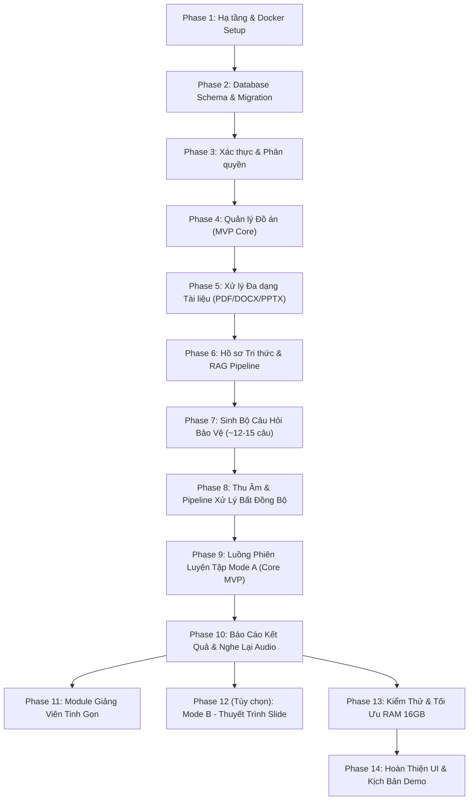

# 📋 Kế Hoạch Triển Khai — ThesisAI (Phiên bản 3.0)

## Tổng Quan Dự Án

> **ThesisAI — Hệ thống quản lý Đồ án tốt nghiệp tích hợp các chức năng hỗ trợ bảo vệ Đồ án bằng AI**
> *(Phiên bản bám sát đặc tả kỹ thuật v3.0: Local-First, Voice-First, Xử lý bất đồng bộ, Chạy tối ưu trên máy cá nhân 16 GB RAM)*

### Bản chất dự án
- **Hệ thống chính:** Nền tảng quản lý đồ án tốt nghiệp (quản lý đề tài, tài liệu, tiến độ cơ bản).
- **Điểm đột phá cốt lõi:** Trợ lý AI hỗ trợ luyện tập bảo vệ đồ án bằng **giọng nói (Voice-first)**, bám sát tài liệu thực tế của sinh viên (**RAG trên tài liệu đồ án**), phân tích cả nội dung lẫn phong thái trình bày.
- **Tính chất điểm số:** Điểm số và đánh giá là công cụ hỗ trợ ôn luyện (ước tính tham khảo), **không thay thế** hội đồng chấm thi chính thức.
- **Nguyên tắc chi phí:** Ưu tiên 100% công nghệ mã nguồn mở chạy local, **không phụ thuộc API trả phí**.

### Đối tượng sử dụng
| Vai trò | Mức độ ưu tiên | Mô tả nghiệp vụ |
|---|---|---|
| **Sinh viên** | 🌟 Chính (Primary) | Quản lý đề tài, tải lên tài liệu, luyện bảo vệ theo câu hỏi (Voice Q&A), nhận phản hồi và báo cáo chi tiết |
| **Giảng viên** | 👤 Phụ (Secondary) | Xem danh sách sinh viên hướng dẫn, duyệt đề tài/tài liệu, xem kết quả luyện tập của sinh viên |
| **Admin** | ⚙️ Tối giản (Optional) | Quản trị tài khoản cơ bản nếu cần demo (không để tính năng admin làm loãng tiến độ MVP) |

### Ràng buộc phần cứng máy phát triển (Dev Environment)
- **Cấu hình máy chủ dev:** CPU AMD Ryzen 7 8745H, Card tích hợp AMD Radeon 780M, **RAM 16 GB**.
- **Chiến lược tối ưu tài nguyên:**
  - Bộ nhớ RAM 16 GB được chia sẻ giữa hệ điều hành, IDE, Docker, Next.js, FastAPI, PostgreSQL và các model AI.
  - Phải kiểm soát chặt chẽ dung lượng model: Chọn model LLM (Ollama) kích thước 3B hoặc 7B quantization (`qwen2.5:3b` / `qwen2.5:7b`), STT dùng `faster-whisper` (`base` hoặc `small`).
  - Giới hạn concurrency của worker xử lý ngầm (chạy tuần tự hoặc tối đa 1 worker đồng thời cho tác vụ nặng) để tránh tràn RAM (OOM).

---

### Tech Stack Chi Tiết

| Tầng | Công nghệ lựa chọn | Ghi chú & Mục đích |
|---|---|---|
| **Frontend** | Next.js (App Router) + TypeScript + Tailwind CSS + shadcn/ui | Giao diện hiện đại, tối ưu thu âm `MediaRecorder`, hiển thị trạng thái xử lý theo thời gian thực |
| **Backend** | Python + FastAPI + SQLAlchemy + Alembic + Pydantic | API bất đồng bộ hiệu năng cao, điều phối background worker xử lý audio và RAG |
| **Database** | PostgreSQL + pgvector (extension) | Lưu trữ quan hệ thực thể và vector embeddings của tài liệu đồ án |
| **Tài liệu** | PyMuPDF (PDF), `python-docx` (Word), `python-pptx` (PowerPoint) | Trích xuất cấu trúc văn bản, số trang/slide và tiêu đề chương mục |
| **Speech-to-Text** | `faster-whisper` / `whisper` (Local) | Nhận diện giọng nói tiếng Việt/tiếng Anh thành văn bản kèm timestamp |
| **Audio Analysis** | `librosa` / `Parselmouth` | Phân tích các chỉ số khách quan: Tốc độ nói (wpm), thời gian ngập ngừng (pause), từ đệm (filler words) |
| **LLM & Embedding** | Ollama (`qwen2.5`) + BGE / E5 Multilingual Embedding | Mô hình ngôn ngữ cục bộ, bảo mật dữ liệu, không tốn phí token |
| **Task Queue** | FastAPI `BackgroundTasks` (giai đoạn đầu) / Redis + RQ (nếu cần mở rộng) | Xử lý bất đồng bộ các câu trả lời âm thanh mà không block request người dùng |
| **Lưu trữ file** | Local File Storage (ngoài public root) | Lưu tài liệu PDF/DOCX và file âm thanh ghi âm `.webm`/`.wav` |
| **Môi trường** | Docker & Docker Compose | Đóng gói PostgreSQL (pgvector), Ollama, Backend, Frontend |

---

## 🗺️ Lộ Trình Các Giai Đoạn Triển Khai (Phases)



> [!IMPORTANT]
> **Nguyên tắc cốt lõi của v3.0:**
> 1. **Voice-first & Async-first:** Thu âm từng câu trả lời độc lập, sinh viên trả lời xong câu nào thì câu đó lập tức được đẩy vào hàng đợi xử lý ngầm, sinh viên tiếp tục làm câu sau mà không phải chờ đợi.
> 2. **RAG Grounding:** Câu hỏi và đánh giá phải dựa trên bằng chứng tài liệu đồ án, không bịa đặt thông tin.
> 3. **Trung thực về trạng thái:** Hiển thị nhãn tiến trình thực tế, không dùng phần trăm giả tạo; nếu lỗi phải dán nhãn `partial_failed` hoặc `failed` rõ ràng.

---

## Chi Tiết Các Giai Đoạn Thực Hiện

---

### Phase 1 — Hạ Tầng & Cấu Hình Môi Trường Dev ⚙️
**Mục tiêu:** Khởi động toàn bộ môi trường phát triển cục bộ và qua Docker Compose, sẵn sàng cổng kết nối và thư mục lưu trữ an toàn.

#### Công việc cụ thể:
1. **Khởi tạo Frontend:** Next.js (App Router) với TypeScript, Tailwind CSS, cài đặt các thành phần UI shadcn cần thiết.
2. **Khởi tạo Backend:** Cấu trúc FastAPI chuẩn theo mô hình phân tầng:
   ```text
   backend/app/
   ├── api/routes/          # Các endpoint router
   ├── core/                # Config, bảo mật, hằng số
   ├── db/                  # Session SQLAlchemy, base
   ├── models/              # SQLAlchemy ORM models
   ├── schemas/             # Pydantic schemas (Request/Response)
   ├── repositories/        # Tương tác DB
   ├── services/            # Logic nghiệp vụ (audio, doc, rag, llm, eval)
   └── storage/             # Quản lý file cục bộ
   ```
3. **Thư mục lưu trữ an toàn:** Tạo cấu trúc thư mục lưu trữ cục bộ ngoài web root:
   - `storage/uploads/documents/` (chứa PDF, DOCX, PPTX)
   - `storage/uploads/audio/` (chứa file ghi âm câu trả lời)
4. **Docker Compose:**
   - `postgres`: Image `pgvector/pgvector:pg16`, cấu hình database `thesisai`.
   - `ollama`: Image `ollama/ollama`, ánh xạ volume để lưu model không bị mất khi restart.
   - `backend` & `frontend` cấu hình Dockerfile tương ứng.
5. **Cấu hình biến môi trường (`.env.example`):**
   - Cấu hình cổng kết nối DB, Ollama base URL, thư mục upload, tham số model whisper/ollama.
6. **Healthcheck Endpoints:** `GET /health` kiểm tra kết nối Database, Ollama và kiểm tra dung lượng ổ đĩa.

#### Tiêu chí hoàn thành:
- [ ] Khởi chạy được Postgres (pgvector) và Ollama.
- [ ] Backend FastAPI kết nối thành công tới Postgres và Ollama.
- [ ] Frontend kết nối được tới Backend qua API client.

---

### Phase 2 — Cơ Sở Dữ Liệu & Migrations 🗄️
**Mục tiêu:** Định nghĩa đầy đủ các bảng dữ liệu theo đặc tả v3.0, hỗ trợ lưu trữ vector, quản lý job bất đồng bộ và file âm thanh.

#### Danh sách thực thể dữ liệu (11 bảng cốt lõi):
1. `users`: id, name, email/username, password_hash, role (`student`, `lecturer`, `admin`), timestamps.
2. `thesis_projects`: id, student_id, supervisor_id, title, topic, description, status, timestamps.
3. `documents`: id, project_id, original_filename, mime_type, storage_path, file_size, content_hash, processing_status, error_message, timestamps.
4. `document_chunks`: id, document_id, project_id, chunk_index, section_title, page_number/slide_number, text, embedding (Vector), timestamps.
5. `project_knowledge_profiles`: id, project_id, version, profile_json, source_document_ids, status, timestamps.
6. `practice_sessions`: id, project_id, mode (`question_answer`, `full_presentation`), status, knowledge_profile_version, started_at, ended_at.
7. `questions`: id, session_id, order_index, question_text, difficulty, topic_competency, expected_answer_outline, source_chunk_ids, recommended_seconds (mặc định 120s).
8. `answers`: id, question_id, audio_path, audio_mime_type, duration_seconds, transcript, transcript_segments, processing_status, error_fields, timestamps.
9. `answer_evaluations`: id, answer_id, content_score, delivery_score, overall_score, criterion_scores_json, feedback_json, evidence_json, model_metadata_json.
10. `presentation_slide_events`: (Dành cho Mode B) id, session_id, slide_index, event_type, elapsed_ms.
11. `processing_jobs`: id, session_id, answer_id, job_type (`stt`, `evaluation`, `audio_metrics`), status, attempt_count, error_code, timestamps.

#### Công việc cụ thể:
1. Viết SQLAlchemy Models cho toàn bộ 11 bảng trên.
2. Kích hoạt extension `vector` trong PostgreSQL.
3. Thiết lập Alembic và tạo migration đầu tiên.
4. Đánh chỉ mục (Index) tìm kiếm vector (HNSW/IVFFlat) và khoá ngoại (Foreign Keys).

#### Tiêu chí hoàn thành:
- [ ] Lệnh `alembic upgrade head` chạy trơn tru, tạo đủ bảng và quan hệ.
- [ ] Không lưu trực tiếp nhị phân file (audio/tài liệu) trong Postgres, chỉ lưu đường dẫn `storage_path`.

---

### Phase 3 — Xác Thực & Phân Quyền 🔐
**Mục tiêu:** Hệ thống đăng nhập, đăng ký bảo mật, phân quyền chuẩn cho Sinh viên và Giảng viên.

#### Công việc cụ thể:
1. Triển khai băm mật khẩu (`passlib` / `bcrypt`).
2. Cơ chế JWT Token lưu trong HTTP-only Cookie hoặc Authorization Header.
3. Middleware / Dependency Injection kiểm tra quyền:
   - `get_current_user`: Lấy thông tin user hiện tại.
   - `require_student`: Sinh viên chỉ được truy cập đồ án của chính mình.
   - `require_lecturer`: Giảng viên chỉ xem được đồ án mình hướng dẫn.
4. Giao diện Login / Register đẹp mắt, dễ sử dụng.

#### Tiêu chí hoàn thành:
- [ ] Đăng ký/đăng nhập sinh viên và giảng viên thành công.
- [ ] API chặn truy cập chéo dữ liệu giữa các sinh viên (HTTP 403/404).

---

### Phase 4 — Quản Lý Đồ Án Tinh Gọn (Student Dashboard) 📚
**Mục tiêu:** Sinh viên tạo và quản lý đồ án tốt nghiệp của mình, giao diện trực quan tập trung vào chuẩn bị bảo vệ.

#### Công việc cụ thể:
1. CRUD đồ án: Tạo đề tài, mô tả, năm học, giảng viên hướng dẫn.
2. Trạng thái đồ án: `PLANNING` → `IN_PROGRESS` → `READY_FOR_DEFENSE` → `COMPLETED`.
3. Giao diện Student Dashboard:
   - Hiển thị tên đề tài, tiến độ tổng quan.
   - Trạng thái hồ sơ tài liệu (đã sẵn sàng để luyện tập hay chưa).
   - Nút hành động nhanh: **"Bắt đầu Luyện tập Bảo vệ" (Start Practice)**.

#### Tiêu chí hoàn thành:
- [ ] Sinh viên tạo được đề tài đồ án.
- [ ] Dashboard hiển thị trực quan thông tin đồ án và tài liệu.

---

### Phase 5 — Xử Lý Đa Dạng Tài Liệu (PDF, DOCX, PPTX) 📄
**Mục tiêu:** Tải lên các định dạng tài liệu đồ án phổ biến, trích xuất cấu trúc văn bản kèm số trang/slide và chia nhỏ (chunking).

#### Bảng trạng thái xử lý tài liệu (UI Tiếng Việt):
| Mã trạng thái | Nhãn UI hiển thị | Ý nghĩa |
|---|---|---|
| `uploaded` | Đã tải lên | File đã lưu an toàn trên ổ đĩa |
| `extracting` | Đang đọc tài liệu | Trích xuất nội dung văn bản & cấu trúc |
| `indexing` | Đang chuẩn bị dữ liệu | Đang chia chunk và vector hóa |
| `ready` | Sẵn sàng | Tài liệu đã sẵn sàng để tạo câu hỏi và RAG |
| `failed` | Xử lý thất bại | Lỗi định dạng/tệp hỏng, có thông báo cụ thể |

#### Công việc cụ thể:
1. **API Upload an toàn:**
   - Kiểm tra định dạng (PDF, DOCX, PPTX), kích thước tối đa (ví dụ 50MB).
   - Đổi tên file ngẫu nhiên (UUID), lưu ngoài public root.
2. **Bộ parser chuyên biệt:**
   - PDF: Dùng **PyMuPDF** (`fitz`), trích xuất văn bản kèm số trang (`page_number`), lọc trang trắng/bìa.
   - DOCX: Dùng **`python-docx`**, trích xuất theo đoạn (`paragraph`) và tiêu đề chương mục (`Heading`).
   - PPTX: Dùng **`python-pptx`**, trích xuất theo từng slide (`slide_number`) và ghi chú (`notes`).
3. **Chunking Service:**
   - Chia đoạn 500–800 tokens, gối đầu (overlap) 50–100 tokens.
   - Bảo toàn metadata nguồn: `document_id`, `page_number` / `slide_number`, `section_title`, `chunk_index`.
4. **Xử lý ngầm (Background Task):** Upload trả về HTTP 200 ngay, tác vụ trích xuất chạy ngầm cập nhật trạng thái `processing_status`.

#### Tiêu chí hoàn thành:
- [ ] Tải lên và trích xuất thành công cả file PDF, Word và PowerPoint.
- [ ] Chunks được lưu vào DB kèm chính xác số trang/slide xuất xứ.
- [ ] Bắt các lỗi file mã hóa, file rỗng và hiển thị thông báo an toàn.

---

### Phase 6 — Hồ Sơ Tri Thức & RAG Pipeline 🧠
**Mục tiêu:** Tạo bản tóm tắt tri thức đồ án (Knowledge Profile) và xây dựng hệ thống truy vấn ngữ nghĩa pgvector chuẩn xác.

#### Công việc cụ thể:
1. **Embedding Provider:**
   - Tích hợp model cục bộ (ví dụ: `BAAI/bge-m3` hoặc `multilingual-e5-base`).
   - Tạo vector cho từng chunk và lưu vào cột `embedding` trong `document_chunks`.
2. **Project Knowledge Profile:**
   - Sử dụng LLM tổng hợp các thông tin cốt lõi từ các tài liệu thành 1 hồ sơ JSON:
     * Vấn đề/mục tiêu của đề tài.
     * Kiến trúc hệ thống, công nghệ sử dụng và lý do lựa chọn.
     * Mô hình dữ liệu, thuật toán chính.
     * Kết quả đạt được, hạn chế và hướng phát triển.
     * Các thông tin tài liệu không đề cập (đánh dấu rõ là chưa có bằng chứng).
3. **Vector Retriever Scoped:**
   - Truy vấn ngữ nghĩa tương đồng (Cosine similarity).
   - **Bắt buộc:** Luôn filter điều kiện `WHERE project_id = :project_id` (tuyệt đối không để rò rỉ dữ liệu giữa các đồ án khác nhau).
4. **RAG Pipeline Test:** Truy vấn thử nghiệm: đưa câu hỏi kỹ thuật → lấy top 3–5 chunks → ghép ngữ cảnh → LLM sinh câu trả lời có trích dẫn nguồn.

#### Tiêu chí hoàn thành:
- [ ] Knowledge Profile được tạo tự động sau khi tài liệu xử lý xong.
- [ ] Tìm kiếm vector hoạt động nhanh chóng, chính xác trên pgvector.
- [ ] LLM trả lời bám sát bằng chứng đồ án, nêu rõ số trang/slide trích dẫn.

---

### Phase 7 — Sinh Bộ Câu Hỏi Bảo Vệ (Question Generation) ❓
**Mục tiêu:** AI tự động sinh bộ câu hỏi (~12–15 câu) bám sát nội dung đồ án thực tế, đa dạng chủ đề và tăng dần độ khó.

#### Cấu trúc bộ câu hỏi:
- **Số lượng:** Khoảng 12–15 câu (nếu tài liệu đủ thông tin).
- **Phân bổ độ khó:**
  - *Dễ (Easy - ~3-4 câu):* Tổng quan đề tài, bài toán giải quyết, phạm vi.
  - *Trung bình (Medium - ~5-6 câu):* Thiết kế kiến trúc, mô hình dữ liệu, công nghệ đã chọn và lý do.
  - *Khó/Chuyên sâu (Hard - ~3-4 câu):* Thuật toán, bảo mật, xử lý ngoại lệ, thách thức kỹ thuật lớn nhất, hạn chế và giải pháp tương lai.
- **Mỗi câu hỏi gồm:**
  - Nội dung câu hỏi (`question_text`).
  - Lĩnh vực/năng lực (`topic_competency`).
  - Dàn ý câu trả lời kỳ vọng (`expected_answer_outline`).
  - Chunks tài liệu làm căn cứ (`source_chunk_ids`).
  - Thời gian khuyến nghị (`recommended_seconds` = 120 giây).

#### Công việc cụ thể:
1. Thiết kế prompt mẫu sinh câu hỏi có cấu trúc Pydantic JSON.
2. Service `QuestionGenerator` kết hợp Knowledge Profile và các chunk đại diện.
3. Khử trùng lặp câu hỏi, cố định bộ câu hỏi cho một phiên (session) cụ thể.
4. API khởi tạo phiên luyện tập: `POST /api/projects/{id}/practice/sessions`.

#### Tiêu chí hoàn thành:
- [ ] Sinh được bộ câu hỏi chất lượng cao, phản ánh đúng đồ án của sinh viên.
- [ ] Có kèm dàn ý kỳ vọng để làm thước đo chấm điểm.

---

### Phase 8 — Thu Âm & Pipeline Xử Lý Bất Đồng Bộ 🎙️⚡
**Mục tiêu:** Xây dựng tính năng ghi âm câu trả lời phía sinh viên và pipeline xử lý ngầm (STT + Đánh giá + Phân tích âm thanh).

#### 1. Trải nghiệm thu âm (Voice-First UX trên Frontend):
- Mỗi câu hỏi có nút bấm bắt đầu/kết thúc ghi âm riêng biệt dùng `MediaRecorder` (`audio/webm` hoặc `audio/wav`).
- Hiển thị đồng hồ đếm thời gian: Khuyến nghị **120 giây**.
- **Quy tắc quan trọng:**
  - Khi vượt quá **150 giây**, hiển thị thông báo nhắc nhở nhẹ nhàng (ví dụ: *"Đã vượt thời gian khuyến nghị"*).
  - **TUYỆT ĐỐI KHÔNG TỰ ĐỘNG NGẮT GHI ÂM** — quyền kết thúc ghi âm hoàn toàn do sinh viên quyết định.
- Cho phép sinh viên nghe lại audio trước khi nộp (hoặc tự động nộp khi bấm dừng).
- Bắt các trường hợp lỗi: Không cấp quyền micro, ghi âm quá ngắn (< 3 giây), file hỏng.

#### 2. Luồng xử lý bất đồng bộ phía Backend:
```text
Sinh viên bấm Nộp câu 1
   │
   ▼
[POST /api/sessions/{id}/answers] ──► Lưu file audio vào ổ đĩa, tạo record Answer với status='queued'
   │
   ├───────────────────────────────► [HTTP 200 Trả về ngay] ──► Sinh viên bấm qua Câu 2 trả lời tiếp
   ▼
[Background Task kích hoạt]
   │
   ├─► Bước 1: STT bằng faster-whisper ──► Lấy transcript kèm timestamps ──► Cập nhật status='transcribing'
   │
   ├─► Bước 2: RAG Retriever ───────────► Lấy căn cứ tài liệu liên quan câu hỏi & transcript
   │
   ├─► Bước 3: Phân tích âm thanh ───────► librosa tính speaking rate (từ/phút), số lần ngập ngừng (pauses)
   │
   ├─► Bước 4: LLM Đánh giá (Rubric) ────► Chấm điểm nội dung & tổng hợp phản hồi ──► status='evaluating'
   │
   ▼
[Lưu kết quả vào answer_evaluations] ──► Cập nhật Answer status='completed'
```

#### 3. Rubric đánh giá đa chiều:
- **Nội dung (80%):**
  - Tính chính xác kỹ thuật và bám sát tài liệu đồ án (Technical Accuracy & Evidence).
  - Tính đầy đủ, đúng trọng tâm câu hỏi (Completeness & Relevance).
  - Giải thích được nguyên nhân, lý do chọn giải pháp (Reasoning & Trade-offs).
- **Kỹ năng trình bày (20% - Thử nghiệm):**
  - Tốc độ nói phù hợp (100–140 từ/phút), mức độ lưu loát (ít khoảng lặng chết quá dài).
  - *Nguyên tắc đạo đức:* Không phán đoán cảm xúc, sự tự tin hay tính trung thực qua giọng nói; chỉ nhận xét các chỉ số đo đạc khách quan.

#### Tiêu chí hoàn thành:
- [ ] Ghi âm hoạt động ổn định trên trình duyệt, lưu file audio nghe lại rõ ràng.
- [ ] API nhận audio phản hồi trong < 500ms, không bắt sinh viên chờ đợi suy luận AI.
- [ ] Background job hoàn thành tuần tự: STT → Đánh giá → Lưu DB.

---

### Phase 9 — Điều Phối Phiên Luyện Tập (Mode A — Core Flow) 🔄
**Mục tiêu:** Hoàn thiện giao diện và logic phiên hỏi đáp hoàn chỉnh, sinh viên làm liên tục từ câu đầu đến câu cuối.

#### Giao diện phòng luyện tập (Defense Room):
- Thanh tiến trình: Hiển thị danh sách câu hỏi 1/15, 2/15...
- Trạng thái xử lý của từng câu (icon nhỏ hiển thị: Đã nộp/Đang xử lý/Đã xong).
- Khu vực câu hỏi: Nội dung, độ khó, chủ đề, thời gian khuyến nghị.
- Khu vực micro và bộ đếm giờ.
- Nút "Câu tiếp theo" kích hoạt ngay sau khi nộp file âm thanh câu hiện tại.
- Nút "Kết thúc phiên" khi hoàn thành câu cuối cùng.

#### Tiêu chí hoàn thành:
- [ ] Sinh viên hoàn thành trọn vẹn 12–15 câu hỏi liên tục mà không gặp lỗi nghẽn giao diện.
- [ ] Khi sinh viên kết thúc phiên, hệ thống kiểm tra trạng thái các job ngầm.

---

### Phase 10 — Báo Cáo Đánh Giá & Nghe Lại Audio (Final Report) 📊
**Mục tiêu:** Trang tổng kết kết quả luyện tập toàn diện, minh bạch và có bằng chứng đối soát.

#### Nội dung báo cáo luyện tập:
1. **Tổng quan phiên:**
   - Điểm đánh giá ước tính tổng thể (trên thang 10).
   - Tỷ lệ hoàn thành câu hỏi, thời gian tổng cộng.
   - Nhận định chung về mức độ sẵn sàng bảo vệ.
2. **Chi tiết từng câu hỏi:**
   - Nội dung câu hỏi và độ khó.
   - **Trình phát audio (Audio Player)** để sinh viên tự nghe lại câu trả lời của mình.
   - Bản gỡ băng văn bản (Transcript do Whisper sinh ra).
   - Điểm số nội dung + phong thái.
   - Điểm mạnh (Strengths) và Điểm còn thiếu sót (Missing points / Gaps).
   - Gợi ý câu trả lời tốt hơn và trích dẫn trang/slide tài liệu đồ án để sinh viên ôn tập lại.
3. **Xử lý ngoại lệ công thực:**
   - Nếu có câu bị lỗi xử lý STT/LLM, hiển thị trạng thái `partial_failed` (Hoàn tất một phần) và chỉ rõ câu nào gặp lỗi, không được làm tròn hay giấu lỗi.

#### Tiêu chí hoàn thành:
- [ ] Báo cáo tải đầy đủ thông tin sau khi tất cả các job ngầm hoàn thành.
- [ ] Trình phát audio phát tốt file âm thanh của từng câu.
- [ ] Trích dẫn bằng chứng rõ ràng, giúp ích thực tế cho sinh viên.

---

### Phase 11 — Module Giảng Viên Tinh Gọn 👨‍🏫
**Mục tiêu:** Cung cấp góc nhìn giám sát cho Giảng viên hướng dẫn một cách nhanh gọn, tập trung.

#### Công việc cụ thể:
1. Giao diện Giảng viên đăng nhập:
   - Danh sách sinh viên và đề tài mình đang hướng dẫn.
   - Xem tài liệu sinh viên đã tải lên.
   - Xem lịch sử và báo cáo các phiên luyện tập của sinh viên.
2. Tính năng phản hồi nhanh (Optional): Giảng viên có thể xem transcript và để lại ghi chú ngắn cho sinh viên.

#### Tiêu chí hoàn thành:
- [ ] Giảng viên xem đúng danh sách sinh viên được phân công.
- [ ] Xem được báo cáo kết quả luyện tập của sinh viên.

---

### Phase 12 (Tùy Chọn / Mở Rộng) — Mode B: Luyện Thuyết Trình Toàn Bộ Đồ Án 🖥️
*(Chỉ triển khai khi Mode A đã vận hành hoàn hảo và còn đủ thời gian)*

#### Ý tưởng Mode B:
- Sinh viên tải lên slide PPTX, trình chiếu trực tiếp trên web (15–20 phút).
- Hệ thống ghi âm một luồng audio liên tục xuyên suốt buổi trình bày.
- Ghi nhận sự kiện chuyển slide: `(slide_index, elapsed_time_ms)`.
- Sau buổi thuyết trình: Cắt phân đoạn âm thanh tương ứng với từng slide dựa trên timestamp.
- Đánh giá tổng thể: Phân bổ thời gian giữa các slide, sự ăn khớp giữa lời nói và nội dung slide.

---

### Phase 13 — Kiểm Thử & Tối Ưu Hóa Bộ Nhớ Trên Máy 16GB RAM 🧪⚡
**Mục tiêu:** Đảm bảo hệ thống vận hành bền bỉ trên máy cá nhân, không bị crash vì thiếu RAM/VRAM.

#### Công việc cụ thể:
1. **Kiểm thử tự động:**
   - Unit tests: Parser PDF/DOCX/PPTX, Chunking, Băm mật khẩu, Tính điểm rubric.
   - Integration tests: Upload tài liệu → Chạy trích xuất → Lưu DB.
   - Audio Pipeline test: Upload audio giả lập → Chạy Whisper → Chạy LLM Eval.
2. **Benchmark & Đo đạc tài nguyên (Ryzen 7 8745H / 16GB RAM):**
   - Đo mức RAM chiếm dụng khi `faster-whisper` và `Ollama` cùng hoạt động.
   - Giới hạn worker: Cấu hình chỉ chạy tối đa **1 tác vụ nặng** tại một thời điểm (tuần tự hóa việc gỡ băng STT và gọi LLM).
   - Thiết lập cơ chế timeout an toàn nếu mô hình phản hồi quá lâu.

#### Tiêu chí hoàn thành:
- [ ] Hệ thống chạy trơn tru 1 phiên 15 câu trên máy 16GB RAM mà không bị tràn RAM (OOM).
- [ ] Toàn bộ test suite vượt qua với kết quả ổn định.

---

### Phase 14 — Hoàn Thiện & Kịch Bản Demo Bảo Vệ 🎯
**Mục tiêu:** Đánh bóng giao diện, viết tài liệu hướng dẫn và chuẩn bị kịch bản demo mẫu cho lễ bảo vệ tốt nghiệp.

#### Công việc cụ thể:
1. **Hoàn thiện UI/UX:** Responsive, chế độ sáng/tối, các thông báo trạng thái bằng tiếng Việt chỉn chu.
2. **Kịch bản Demo chuẩn (Demo Scenario):**
   - Bước 1: Sinh viên đăng nhập, vào đồ án mẫu (ví dụ: *Hệ thống dự đoán kết quả bóng đá bằng AI*).
   - Bước 2: Tải lên tài liệu PDF luận văn & slide PPTX.
   - Bước 3: Xem trạng thái hệ thống tự động trích xuất và tạo hồ sơ tri thức.
   - Bước 4: Khởi động phòng luyện tập (Mode A), hệ thống sinh 12 câu hỏi bám sát luận văn.
   - Bước 5: Bấm micro trả lời thử 2–3 câu thực tế bằng tiếng Việt.
   - Bước 6: Quan sát hệ thống xử lý ngầm trong khi sinh viên chuyển câu tiếp theo.
   - Bước 7: Kết thúc phiên, mở Báo cáo: Nghe lại giọng nói của mình, xem điểm số, nhận xét điểm mạnh/yếu và trích dẫn trang tài liệu tương ứng.
   - Bước 8: Đăng nhập tài khoản Giảng viên xem lại kết quả vừa hoàn thành.
3. **Tài liệu README hoàn chỉnh:** Hướng dẫn chạy `docker compose up` hoặc chạy local từng bước rõ ràng.

---

## ⚠️ Những Điều Tuyệt Đối KHÔNG Được Làm (Anti-Patterns)

1. ❌ **Không làm chatbot chat văn bản thông thường:** Tính năng luyện tập bảo vệ phải lấy **giọng nói (Voice-first)** làm trọng tâm.
2. ❌ **Không tự ý ngắt ghi âm cứng của sinh viên:** Sau 150s chỉ hiển thị nhắc nhở nhẹ nhàng, người dùng tự bấm dừng.
3. ❌ **Không block HTTP request:** Khi upload âm thanh, API phải lưu file và trả về ngay, mọi suy luận AI bắt buộc chạy nền (background).
4. ❌ **Không phụ thuộc API trả phí ngoài:** Toàn bộ STT, LLM, Embedding chạy hoàn toàn trên máy local (Ollama + local Whisper).
5. ❌ **Không để AI bịa thông tin đồ án:** Mọi câu hỏi và đánh giá phải có chunk tài liệu làm căn cứ (`source_chunk_ids`).
6. ❌ **Không truy cập chéo dữ liệu:** Tuyệt đối không để sinh viên này xem hoặc tìm kiếm vector vào tài liệu của sinh viên khác.
7. ❌ **Không lưu file nhị phân trong cơ sở dữ liệu:** Audio và tài liệu lưu trong hệ thống file cục bộ, DB chỉ lưu đường dẫn `storage_path`.
8. ❌ **Không giả mạo phần trăm tiến trình:** Trạng thái xử lý phải trung thực theo các nhãn: `uploaded`, `extracting`, `indexing`, `ready`, `queued`, `transcribing`, `evaluating`, `completed`, `partial_failed`, `failed`.
9. ❌ **Không phán đoán cảm xúc/tâm lý qua giọng nói:** Chỉ phân tích các thông số định lượng khách quan (tốc độ nói, khoảng ngập ngừng).

---

## ✅ Định Nghĩa "Hoàn Thành" Của Dự Án (Definition of Done)

Hệ thống được coi là hoàn thành bảo vệ đồ án tốt nghiệp khi:
- [x] Sinh viên tạo được đồ án, tải lên được tài liệu (PDF, DOCX, PPTX).
- [x] Tài liệu được trích xuất, chia chunk và lưu vector thành công vào PostgreSQL.
- [x] Hệ thống tự động sinh bộ câu hỏi 12–15 câu bám sát đồ án.
- [x] Sinh viên ghi âm câu trả lời trực tiếp trên trình duyệt bằng micro.
- [x] File âm thanh được tải lên và xử lý bất đồng bộ (STT `faster-whisper` + RAG + LLM `Ollama`).
- [x] Báo cáo chi tiết hiển thị đầy đủ transcript, trình phát audio, điểm số ước tính, điểm mạnh/yếu và gợi ý ôn tập.
- [x] Giảng viên xem được danh sách sinh viên và kết quả luyện tập.
- [x] Hoạt động ổn định trên máy tính cá nhân 16 GB RAM mà không cần kết nối API trả phí.
- [x] Có hướng dẫn cài đặt và khởi chạy minh bạch trong `README.md`.
